# AR STEM Platform — Production-Oriented ERD Specification

> Adoption note: this spec is a production-wide reference, not the pilot
> baseline. Binding pilot decisions live in `docs/architecture.md` (see
> "Relation to the v2 ERD spec" for adopted / deferred / superseded items).
> Its "new baseline" claim (section 30) predates the pilot's directives,
> mental-model, and impact-scoring requirements.

**Status:** Revised after critical engineering review  
**Target:** Grades 6–12 AI-assisted AR STEM learning platform  
**Primary database assumption:** PostgreSQL for transactional data, object storage for binary assets, event/analytics infrastructure for high-volume telemetry

---

# 1. Purpose

This document defines the revised Entity Relationship Diagram (ERD) and relationship model for the AR STEM platform. It incorporates the initial curriculum, lesson, AR, student-learning, teacher-assistant, assessment, and human-feedback models, plus the additional production concerns identified during engineering review.

The platform is modeled as a **versioned educational content and learning system** rather than a simple lesson viewer. AI agents generate and revise instructional artifacts; students experience immutable published versions; teachers and automated validators inspect outcomes; and approved changes create new artifact versions instead of mutating historical content.

The model must support:

- multi-tenant schools, districts, programs, and independent educators;
- teachers, co-teachers, teaching assistants, reviewers, administrators, guardians, and students;
- curriculum standards and prerequisite knowledge graphs;
- lesson assignments and individualized learning paths;
- AI-generated lessons, assessments, AR worlds, scenes, simulations, and tutor behavior;
- exact content/version provenance;
- student sessions, assessments, mastery evidence, and high-volume telemetry;
- teacher-assistant recommendations with inspectable evidence;
- AR runtime compatibility, anchors, device capabilities, and offline synchronization;
- human review, automated validation, approval, publication, safety, audit, retention, and consent.

---

# 2. Core Architectural Principles

## 2.1 Immutable historical learning records

Anything a student experienced must remain reconstructable later. A learning session therefore references exact published content versions, not only logical lesson/scene identities.

```text
Lesson
  ├── Lesson Version 1
  ├── Lesson Version 2
  └── Lesson Version 3

Student Session A → Lesson Version 2
Student Session B → Lesson Version 3
```

Updating a lesson, prompt, assessment, scene, simulation, asset, or model configuration must create a new version rather than rewriting historical data.

## 2.2 Contextual roles instead of a single user role

A user can hold different roles in different organizations and classrooms. Authorization is therefore modeled through memberships, roles, permissions, and classroom membership rather than a single `USER.role` field.

## 2.3 Curriculum is separate from presentation

Learning standards and objectives describe **what** should be learned. Lessons, assessments, AR scenes, assets, and simulations describe **how** the material is taught.

## 2.4 AI actions are auditable

Every AI-generated artifact or recommendation should be attributable to:

- the agent and agent version;
- model/provider configuration;
- prompt-template version;
- input artifact versions;
- generation parameters;
- output artifact versions;
- validation results;
- approvals and revisions.

## 2.5 Human approval governs consequential changes

Agents may draft, recommend, analyze, and prepare revisions. Publishing curriculum, modifying grades, changing permissions, or other high-impact operations require explicit authorization policies and, where applicable, human approval.

## 2.6 AR runtime state is part of the educational record

AR lessons are not only 3D content. Device capabilities, runtime versions, anchors, simulation versions, session state, and offline synchronization can affect what the student actually experienced and must be modeled accordingly.

---

# 3. Revised Domain Map

```text
IDENTITY & TENANCY
User
Organization
OrganizationMembership
Role
Permission
RolePermission
GuardianProfile
StudentGuardian
ConsentRecord

ACADEMIC OPERATIONS
AcademicTerm
Subject
Course
CourseOffering
Classroom
ClassroomMember
Enrollment
Assignment
AssignmentStudent

CURRICULUM
StandardFramework
LearningStandard
CourseStandard
LearningObjective
ObjectiveStandard
ObjectiveDependency

CONTENT & PROVENANCE
ContentArtifact
ContentArtifactVersion
ArtifactRelationship
Publication
ContentCollection
ContentShare
ContentFork
ContentOwner / ContentLicense

AI & AGENTS
Agent
AgentVersion
AgentCapability
AgentPermission
AgentTool
AgentSession
AgentMessage
AgentAction
AgentRecommendation
RecommendationEvidence
PromptTemplate
PromptTemplateVersion
AIModel
AIModelVersion
ModelConfiguration
GenerationRun
GenerationInput
GenerationOutput
AgentApproval

AR & SIMULATION
WorldBlueprint
WorldBlueprintVersion
Scene
SceneVersion
LessonVersionScene
SceneObject
Interaction
Simulation
SimulationVersion
SimulationParameter
Asset
AssetVersion
AssetVariant
ARSession
ARAnchor
SpatialMap
Device
DeviceCapability
SceneRequirement
RuntimeVersion
SceneSchemaVersion

LEARNING
LearningSession
SessionCheckpoint
LessonProgress
StudentInteraction
TelemetryEvent
LearnerStateSnapshot
AgentMemory
LearningPath
LearningPathStep
Intervention

ASSESSMENT & MASTERY
Assessment
AssessmentVersion
Question
QuestionVersion
Attempt
Rubric
RubricCriterion
Evaluation
RubricScore
MasteryRecord
MasteryEvidence
MasteryModelVersion

GOVERNANCE & QUALITY
Feedback
ContentIssue
IssueEvidence
Review
RevisionRequest
Approval
ValidationRule
ValidationRun
ValidationResult
SafetyEvent
ModerationResult
Escalation
AuditEvent
DataRetentionPolicy
DeletionRequest
AnonymizationJob

ACCESSIBILITY & LOCALIZATION
StudentAccommodation
AccessibilityRequirement
ContentAccessibilityFeature
ContentLocalization
```

---

# 4. Identity, Tenancy, and Authorization

## 4.1 USER

Represents an authenticated person. Global authorization should **not** be stored as one mutable `role` field.

| Field | Type | Notes |
|---|---|---|
| id | UUID PK | |
| email | string unique | |
| status | enum | ACTIVE, INVITED, SUSPENDED, DELETED |
| created_at | timestamptz | |
| updated_at | timestamptz | |

Relationships:

```text
USER 1 ── 0..1 STUDENT_PROFILE
USER 1 ── 0..1 EDUCATOR_PROFILE
USER 1 ── * ORGANIZATION_MEMBERSHIP
USER 1 ── * CLASSROOM_MEMBER
USER 1 ── * AUDIT_EVENT (actor)
```

## 4.2 STUDENT_PROFILE

| Field | Type |
|---|---|
| id | UUID PK |
| user_id | UUID FK → USER |
| grade_level | integer |
| preferred_locale | string |
| learning_preferences | JSONB |

Accessibility accommodations should not be stored only as an opaque JSON field; see `STUDENT_ACCOMMODATION`.

## 4.3 EDUCATOR_PROFILE

| Field | Type |
|---|---|
| id | UUID PK |
| user_id | UUID FK → USER |
| title | string |
| specialization | string nullable |

## 4.4 ORGANIZATION

Represents a district, school, nonprofit, learning program, homeschool organization, or content organization.

| Field | Type |
|---|---|
| id | UUID PK |
| parent_organization_id | UUID FK nullable |
| name | string |
| type | enum |
| status | enum |

Self-reference allows district → school hierarchies.

## 4.5 ORGANIZATION_MEMBERSHIP

Connects users to organizations with contextual access.

| Field | Type |
|---|---|
| id | UUID PK |
| organization_id | UUID FK |
| user_id | UUID FK |
| role_id | UUID FK |
| status | enum |
| joined_at | timestamptz |
| left_at | timestamptz nullable |

```text
USER * ── * ORGANIZATION
      via ORGANIZATION_MEMBERSHIP
```

## 4.6 ROLE / PERMISSION / ROLE_PERMISSION

`ROLE` defines named permission sets. `PERMISSION` represents atomic capabilities. `ROLE_PERMISSION` is the many-to-many junction.

Examples:

```text
TEACHER
CO_TEACHER
TEACHING_ASSISTANT
CURRICULUM_REVIEWER
SCHOOL_ADMIN
DISTRICT_ADMIN
CONTENT_AUTHOR
OBSERVER
```

Permissions can include:

```text
lesson.draft
lesson.review
lesson.publish
assignment.create
student.view
student.grade
agent.execute
agent.approve
organization.manage
```

## 4.7 CLASSROOM_MEMBER

Do not place one `educator_id` directly on `CLASSROOM`. A classroom may have multiple staff members.

| Field | Type |
|---|---|
| id | UUID PK |
| classroom_id | UUID FK |
| user_id | UUID FK |
| role_id | UUID FK |
| joined_at | timestamptz |
| left_at | timestamptz nullable |

```text
USER * ── * CLASSROOM
      via CLASSROOM_MEMBER
```

## 4.8 GUARDIAN_PROFILE / STUDENT_GUARDIAN

Because the product serves minors, guardianship is first-class.

`STUDENT_GUARDIAN` fields:

| Field | Type |
|---|---|
| student_id | UUID FK |
| guardian_id | UUID FK |
| relationship_type | string |
| is_primary | boolean |
| status | enum |

## 4.9 CONSENT_RECORD

Tracks explicit consent and withdrawal for data processing or features.

| Field | Type |
|---|---|
| id | UUID PK |
| student_id | UUID FK |
| guardian_id | UUID FK nullable |
| consent_type | enum |
| policy_version | string |
| granted_at | timestamptz nullable |
| revoked_at | timestamptz nullable |
| source | string |

Potential consent categories include voice processing, camera/AR use, AI interactions, analytics, personalization, and third-party integrations.

---

# 5. Academic Operations

## 5.1 ACADEMIC_TERM

| Field | Type |
|---|---|
| id | UUID PK |
| organization_id | UUID FK |
| name | string |
| starts_at | date |
| ends_at | date |
| status | enum |

## 5.2 SUBJECT

Broad STEM discipline such as Physics, Chemistry, Biology, Mathematics, Engineering, or Computer Science.

```text
SUBJECT 1 ── * COURSE
```

## 5.3 COURSE

Represents a reusable curricular definition such as Algebra I or Introductory Physics.

| Field | Type |
|---|---|
| id | UUID PK |
| subject_id | UUID FK |
| name | string |
| grade_min | integer |
| grade_max | integer |

## 5.4 COURSE_OFFERING

Connects a reusable course to the actual classroom and term where it is taught.

| Field | Type |
|---|---|
| id | UUID PK |
| course_id | UUID FK |
| classroom_id | UUID FK |
| academic_term_id | UUID FK |
| starts_at | date nullable |
| ends_at | date nullable |
| status | enum |

```text
COURSE 1 ── * COURSE_OFFERING
CLASSROOM 1 ── * COURSE_OFFERING
ACADEMIC_TERM 1 ── * COURSE_OFFERING
```

## 5.5 CLASSROOM

| Field | Type |
|---|---|
| id | UUID PK |
| organization_id | UUID FK |
| name | string |
| grade_level | integer nullable |
| status | enum |

## 5.6 ENROLLMENT

Student ↔ classroom junction.

| Field | Type |
|---|---|
| id | UUID PK |
| classroom_id | UUID FK |
| student_id | UUID FK |
| status | enum |
| enrolled_at | timestamptz |
| withdrawn_at | timestamptz nullable |

```text
STUDENT_PROFILE * ── * CLASSROOM
                via ENROLLMENT
```

## 5.7 ASSIGNMENT

Critical bridge between classroom instruction and student learning sessions.

| Field | Type |
|---|---|
| id | UUID PK |
| course_offering_id | UUID FK |
| artifact_version_id | UUID FK → CONTENT_ARTIFACT_VERSION |
| assigned_by_user_id | UUID FK |
| title | string |
| available_at | timestamptz nullable |
| due_at | timestamptz nullable |
| attempt_limit | integer nullable |
| grading_policy | JSONB |
| status | enum |

## 5.8 ASSIGNMENT_STUDENT

Supports individualized assignments, accommodations, exemptions, and status.

| Field | Type |
|---|---|
| id | UUID PK |
| assignment_id | UUID FK |
| student_id | UUID FK |
| status | enum |
| assigned_at | timestamptz |
| completed_at | timestamptz nullable |
| accommodation_override | JSONB nullable |

```text
ASSIGNMENT 1 ── * ASSIGNMENT_STUDENT
STUDENT_PROFILE 1 ── * ASSIGNMENT_STUDENT
ASSIGNMENT_STUDENT 1 ── * LEARNING_SESSION
```

---

# 6. Curriculum and Knowledge Graph

## 6.1 STANDARD_FRAMEWORK

Standards are independent of courses.

| Field | Type |
|---|---|
| id | UUID PK |
| name | string |
| jurisdiction | string nullable |
| version | string |
| effective_from | date nullable |
| effective_to | date nullable |

Examples: NGSS, Common Core, Florida B.E.S.T., district frameworks.

## 6.2 LEARNING_STANDARD

| Field | Type |
|---|---|
| id | UUID PK |
| framework_id | UUID FK |
| parent_standard_id | UUID FK nullable |
| standard_code | string |
| description | text |

## 6.3 COURSE_STANDARD

Many-to-many mapping:

```text
COURSE * ── * LEARNING_STANDARD
       via COURSE_STANDARD
```

## 6.4 LEARNING_OBJECTIVE

Represents a measurable learning outcome.

| Field | Type |
|---|---|
| id | UUID PK |
| canonical_name | string |
| description | text |
| difficulty | enum nullable |
| domain | string nullable |

## 6.5 OBJECTIVE_STANDARD

Objectives may align to more than one standard.

```text
LEARNING_OBJECTIVE * ── * LEARNING_STANDARD
                   via OBJECTIVE_STANDARD
```

## 6.6 OBJECTIVE_DEPENDENCY

Creates a curriculum knowledge graph rather than only a hierarchy.

| Field | Type |
|---|---|
| prerequisite_objective_id | UUID FK |
| dependent_objective_id | UUID FK |
| relationship_type | enum |
| strength | decimal nullable |

Relationship examples:

```text
PREREQUISITE_FOR
SUPPORTS
REINFORCES
RELATED_TO
```

This allows the platform to distinguish a direct misconception from a prerequisite gap.

---

# 7. Generic Educational Content and Provenance

The original ERD repeatedly used polymorphic `target_type + target_id` references. Those are flexible but weaken foreign-key integrity. The revised model introduces a generic educational artifact layer.

## 7.1 CONTENT_ARTIFACT

Stable identity for versionable educational content.

| Field | Type |
|---|---|
| id | UUID PK |
| artifact_type | enum |
| owner_organization_id | UUID FK nullable |
| created_by_user_id | UUID FK nullable |
| canonical_title | string |
| created_at | timestamptz |

Artifact types may include:

```text
LESSON
WORLD_BLUEPRINT
SCENE
ASSESSMENT
QUESTION_SET
RUBRIC
SIMULATION
TUTOR_SCRIPT
ACTIVITY
```

## 7.2 CONTENT_ARTIFACT_VERSION

Immutable content version.

| Field | Type |
|---|---|
| id | UUID PK |
| artifact_id | UUID FK |
| version_number | integer |
| status | enum |
| schema_version | string nullable |
| content | JSONB |
| created_by_user_id | UUID FK nullable |
| created_at | timestamptz |
| supersedes_version_id | UUID FK nullable |

Recommended statuses:

```text
DRAFT
GENERATED
VALIDATING
IN_REVIEW
REVISION_REQUESTED
APPROVED
PUBLISHED
REJECTED
ARCHIVED
```

## 7.3 ARTIFACT_RELATIONSHIP

Models lineage and composition without unsafe arbitrary target IDs.

| Field | Type |
|---|---|
| id | UUID PK |
| source_version_id | UUID FK |
| target_version_id | UUID FK |
| relationship_type | enum |
| sequence | integer nullable |
| metadata | JSONB nullable |

Examples:

```text
CONTAINS
USES
GENERATED_FROM
DERIVED_FROM
REPLACES
ALIGNS_TO
DEPENDS_ON
FORKED_FROM
```

A lesson version can therefore reference exact scene versions, assessment versions, blueprint versions, or simulations.

## 7.4 LESSON_OBJECTIVE

Because learning objectives are curriculum entities rather than generic artifacts, retain an explicit junction:

| Field | Type |
|---|---|
| lesson_version_id | UUID FK → CONTENT_ARTIFACT_VERSION |
| objective_id | UUID FK |
| role | enum nullable |
| weight | decimal nullable |

## 7.5 PUBLICATION

Publishing is separated from artifact status.

| Field | Type |
|---|---|
| id | UUID PK |
| artifact_version_id | UUID FK |
| audience_type | enum |
| audience_id | UUID nullable |
| effective_from | timestamptz |
| effective_until | timestamptz nullable |
| published_by_user_id | UUID FK |
| status | enum |

This allows one content version to be published to a district, organization, classroom, beta cohort, or public library without duplicating the artifact.

## 7.6 CONTENT_OWNER / CONTENT_LICENSE

Track ownership and usage rights for teacher-authored, platform-generated, licensed, or externally sourced content.

## 7.7 CONTENT_COLLECTION / CONTENT_SHARE / CONTENT_FORK

Support discovery, reusable libraries, sharing, cloning, and lineage.

A fork should point to the exact source artifact version.

---

# 8. Prompt and AI Model Provenance

## 8.1 PROMPT_TEMPLATE

Stable prompt identity.

| Field | Type |
|---|---|
| id | UUID PK |
| name | string |
| type | enum |
| description | text nullable |

## 8.2 PROMPT_TEMPLATE_VERSION

Prompt text itself is immutable and versioned.

| Field | Type |
|---|---|
| id | UUID PK |
| prompt_template_id | UUID FK |
| version_number | integer |
| system_prompt | text nullable |
| prompt | text |
| output_schema | JSONB nullable |
| created_at | timestamptz |

## 8.3 AI_MODEL / AI_MODEL_VERSION / MODEL_CONFIGURATION

Stores reproducibility-critical model configuration.

`MODEL_CONFIGURATION` may include:

```text
provider
model_version_id
temperature
seed
reasoning_mode
max_output_tokens
tool_configuration
structured_output_schema
safety_configuration
```

## 8.4 GENERATION_RUN

One AI generation or transformation invocation.

| Field | Type |
|---|---|
| id | UUID PK |
| agent_version_id | UUID FK nullable |
| prompt_template_version_id | UUID FK |
| model_configuration_id | UUID FK |
| parent_run_id | UUID FK nullable |
| status | enum |
| started_at | timestamptz |
| completed_at | timestamptz nullable |
| failure_code | string nullable |

Recommended statuses:

```text
QUEUED
RUNNING
COMPLETED
FAILED
CANCELLED
```

## 8.5 GENERATION_INPUT / GENERATION_OUTPUT

Do not rely exclusively on giant opaque `input_context` / `output` JSON fields.

`GENERATION_INPUT` connects a generation run to exact source artifact versions or structured contextual inputs.

`GENERATION_OUTPUT` connects a generation run to produced artifact versions.

```text
CONTENT_ARTIFACT_VERSION * → GENERATION_INPUT → GENERATION_RUN
GENERATION_RUN → GENERATION_OUTPUT → * CONTENT_ARTIFACT_VERSION
```

This gives the system a queryable provenance graph.

---

# 9. Unified Agent Domain

Instead of separate, increasingly duplicated schemas for every AI role, use one agent framework with typed capabilities.

## 9.1 AGENT

| Field | Type |
|---|---|
| id | UUID PK |
| agent_type | enum |
| name | string |
| owner_organization_id | UUID FK nullable |
| status | enum |

Agent types may include:

```text
STUDENT_TUTOR
TEACHER_ASSISTANT
LESSON_GENERATOR
SCENE_GENERATOR
ASSESSMENT_GENERATOR
VALIDATOR
MASTERY_ANALYST
```

## 9.2 AGENT_VERSION

| Field | Type |
|---|---|
| id | UUID PK |
| agent_id | UUID FK |
| version_number | integer |
| model_configuration_id | UUID FK |
| policy_config | JSONB |
| created_at | timestamptz |

## 9.3 AGENT_CAPABILITY / AGENT_PERMISSION / AGENT_TOOL

Critical permissions should be first-class rather than only embedded in unvalidated JSON.

Example:

```text
Student Tutor
✓ read published lesson
✓ observe current learner state
✓ provide hints
✓ highlight/manipulate allowed scene objects
✕ publish content
✕ alter grades

Teacher Assistant
✓ analyze classroom
✓ generate drafts
✓ propose intervention
✕ publish without required approval
```

## 9.4 AGENT_SESSION

One interaction/work session involving an agent.

| Field | Type |
|---|---|
| id | UUID PK |
| agent_version_id | UUID FK |
| user_id | UUID FK nullable |
| classroom_id | UUID FK nullable |
| learning_session_id | UUID FK nullable |
| started_at | timestamptz |
| ended_at | timestamptz nullable |

## 9.5 AGENT_MESSAGE

Stores conversation history for student-tutor or teacher-assistant experiences.

## 9.6 AGENT_ACTION

| Field | Type |
|---|---|
| id | UUID PK |
| session_id | UUID FK |
| action_type | enum |
| target_artifact_version_id | UUID FK nullable |
| input | JSONB |
| output | JSONB nullable |
| status | enum |
| requires_approval | boolean |
| generation_run_id | UUID FK nullable |

Example actions:

```text
GENERATE_LESSON
REVISE_LESSON
CREATE_ASSESSMENT
GENERATE_SCENE
ANALYZE_CLASSROOM
RECOMMEND_INTERVENTION
SUMMARIZE_PROGRESS
FLAG_CONTENT
HIGHLIGHT_OBJECT
DISPLAY_HINT
MODIFY_ALLOWED_SIMULATION_PARAMETER
```

## 9.7 AGENT_APPROVAL

Human approval for consequential agent actions.

| Field | Type |
|---|---|
| id | UUID PK |
| action_id | UUID FK |
| educator_id | UUID FK |
| decision | enum |
| notes | text nullable |
| decided_at | timestamptz |

## 9.8 AGENT_RECOMMENDATION / RECOMMENDATION_EVIDENCE

Recommendations must be inspectable.

`AGENT_RECOMMENDATION`:

| Field | Type |
|---|---|
| id | UUID PK |
| agent_version_id | UUID FK |
| student_id | UUID FK nullable |
| classroom_id | UUID FK nullable |
| assignment_id | UUID FK nullable |
| recommendation_type | enum |
| rationale | text |
| confidence | decimal |
| status | enum |

`RECOMMENDATION_EVIDENCE` references specific attempts, telemetry summaries, mastery evidence, interactions, or content issues.

A teacher should be able to answer: **Why did the agent make this recommendation?**

## 9.9 AGENT_MEMORY

Explicitly scopes AI memory.

| Field | Type |
|---|---|
| id | UUID PK |
| agent_id | UUID FK |
| student_id | UUID FK nullable |
| scope_type | enum |
| scope_id | UUID |
| memory_type | enum |
| content | JSONB |
| expires_at | timestamptz nullable |

Possible scopes:

```text
SESSION
LESSON
COURSE
STUDENT
CLASSROOM
```

Long-term memory must be policy-controlled rather than inferred from unlimited message history.

---

# 10. AR Content, Runtime, Assets, and Simulation

## 10.1 WORLD_BLUEPRINT / WORLD_BLUEPRINT_VERSION

Keep stable identity separate from versions.

```text
WORLD_BLUEPRINT 1 ── * WORLD_BLUEPRINT_VERSION
```

A blueprint version defines the instructional world contract before runtime scene rendering.

Example payload:

```json
{
  "environment": "moon_surface",
  "learningObjective": "Understand gravitational acceleration",
  "studentGoal": "Compare falling objects",
  "objects": ["hammer", "feather", "timer"],
  "interactions": ["pick_up", "drop", "measure"],
  "avatarRole": "guide",
  "successCondition": "student explains why the objects fall together"
}
```

Where practical, represent the blueprint through `CONTENT_ARTIFACT` / `CONTENT_ARTIFACT_VERSION` and keep `WORLD_BLUEPRINT_VERSION` only for normalized runtime-specific fields.

## 10.2 SCENE / SCENE_VERSION

A logical scene should not be owned directly by one lesson version if it may be reused.

```text
SCENE 1 ── * SCENE_VERSION
```

Scene versions are immutable.

## 10.3 LESSON_VERSION_SCENE

Explicit composition table connecting a lesson version to exact scene versions.

| Field | Type |
|---|---|
| lesson_version_id | UUID FK |
| scene_version_id | UUID FK |
| sequence | integer |
| required | boolean |
| transition_config | JSONB nullable |

This avoids duplicate ownership paths and allows a new lesson version to replace only one changed scene.

## 10.4 ASSET / ASSET_VERSION / ASSET_VARIANT

Binary assets require versioning because replacing a URI in place would alter historical lessons.

`ASSET_VERSION` fields should include:

```text
checksum
uri
format
size_bytes
metadata
created_at
```

`ASSET_VARIANT` supports device-specific representations:

```text
platform
quality_tier
polygon_count
texture_resolution
compression
minimum_capability
```

`SCENE_OBJECT` should reference an exact `ASSET_VERSION` or selected variant policy.

## 10.5 SCENE_OBJECT

Represents a concrete object instance inside a scene version.

| Field | Type |
|---|---|
| id | UUID PK |
| scene_version_id | UUID FK |
| asset_version_id | UUID FK nullable |
| stable_object_key | string |
| name | string |
| object_type | enum |
| transform | JSONB |
| properties | JSONB |

## 10.6 INTERACTION

Defines allowed student or tutor interactions with a scene object.

Examples:

```text
grab
rotate
drop
measure
combine
inspect
activate
push
pull
```

## 10.7 SIMULATION / SIMULATION_VERSION / SIMULATION_PARAMETER

Replace the original one-scene/one-simulation assumption.

```text
SCENE_VERSION 1 ── * SIMULATION_VERSION
SIMULATION 1 ── * SIMULATION_VERSION
```

A scene may contain multiple scientific systems.

Simulation versions should record:

```text
engine_version_id
initial_state
seed
parameter_set
schema_version
```

This supports reproducibility and comparison of student outcomes.

## 10.8 RUNTIME_VERSION / SCENE_SCHEMA_VERSION

Historical scene playback may depend on runtime and schema versions. Record compatibility explicitly rather than assuming all future runtimes can render all previous content.

## 10.9 DEVICE / DEVICE_CAPABILITY

Examples of capabilities:

```text
WebXR
plane_detection
LiDAR
hand_tracking
camera
microphone
minimum_GPU_class
minimum_memory
```

## 10.10 SCENE_REQUIREMENT

Maps scene versions to required or preferred capabilities.

This allows the assignment/runtime layer to answer:

> Can this student's current device run this AR lesson, and which fallback should be used if not?

## 10.11 AR_SESSION

Connects the educational learning session to the actual AR runtime.

| Field | Type |
|---|---|
| id | UUID PK |
| learning_session_id | UUID FK |
| device_id | UUID FK |
| runtime_version_id | UUID FK |
| tracking_mode | string |
| started_at | timestamptz |
| ended_at | timestamptz nullable |
| world_scale | decimal nullable |

## 10.12 AR_ANCHOR / SPATIAL_MAP

`AR_ANCHOR` records object placement against a plane, image marker, geospatial point, or spatial map.

Avoid storing raw environmental/spatial data indefinitely unless necessary; it should be governed by consent and retention policy.

---

# 11. Learning Session and Runtime State

## 11.1 LEARNING_SESSION

A student's execution of an assigned lesson/content version.

| Field | Type |
|---|---|
| id | UUID PK |
| assignment_student_id | UUID FK |
| student_id | UUID FK |
| lesson_version_id | UUID FK |
| status | enum |
| started_at | timestamptz |
| completed_at | timestamptz nullable |
| last_checkpoint_at | timestamptz nullable |

Retain the exact `lesson_version_id` even though the assignment also references content, because assignments may change after a session begins.

Recommended states:

```text
NOT_STARTED
ACTIVE
PAUSED
RESUMABLE
COMPLETED
ABANDONED
TIMED_OUT
FAILED
```

## 11.2 SESSION_CHECKPOINT

Allows restoration of AR worlds and lesson progression after browser/app closure or network interruption.

| Field | Type |
|---|---|
| id | UUID PK |
| learning_session_id | UUID FK |
| scene_version_id | UUID FK |
| checkpoint_sequence | integer |
| state | JSONB |
| created_at | timestamptz |

## 11.3 LESSON_PROGRESS

Reference exact scene versions or `LESSON_VERSION_SCENE`, not only logical `SCENE`.

| Field | Type |
|---|---|
| id | UUID PK |
| learning_session_id | UUID FK |
| lesson_version_scene_id | UUID FK |
| progress | decimal |
| completed_at | timestamptz nullable |

## 11.4 STUDENT_INTERACTION

Captures semantically meaningful interaction with scene objects.

Include:

```text
client_generated_id
learning_session_id
scene_object_id
interaction_type
payload
device_timestamp
server_timestamp
sync_status
```

## 11.5 LEARNER_STATE_SNAPSHOT

Stores a projection of current learning state for low-latency tutor reasoning.

Potential fields:

```text
current_scene
current_objective
recent_mistakes
hints_used
mastery_estimates
active_misconceptions
session_summary
```

Do not treat snapshots as canonical evidence; they are derived projections.

## 11.6 OFFLINE SYNCHRONIZATION

Important mobile/AR events should support:

```text
client_generated_id
sequence_number
device_timestamp
server_received_at
sync_status
```

Server ingestion must be idempotent so reconnect/replay does not duplicate attempts or telemetry.

---

# 12. Telemetry and Analytics

## 12.1 TELEMETRY_EVENT

High-volume behavioral events are distinct from authoritative domain records.

| Field | Type |
|---|---|
| id | UUID / sortable event ID |
| learning_session_id | UUID |
| client_event_id | UUID |
| sequence_number | bigint |
| event_type | string |
| schema_version | string |
| payload | JSONB |
| device_timestamp | timestamptz |
| received_at | timestamptz |
| device_id | UUID nullable |

Examples:

```text
scene_entered
scene_completed
object_selected
object_moved
hint_requested
simulation_started
simulation_reset
avatar_interrupted
session_paused
```

## 12.2 DOMAIN EVENTS VS ANALYTICS TELEMETRY

Do not make high-volume telemetry the source of truth for grades, assignment completion, approvals, or other business state.

Use transactional relational records for authoritative state and stream/copy telemetry into scalable analytics infrastructure as volume grows.

---

# 13. Assessment, Rubrics, and Evaluation

## 13.1 ASSESSMENT / ASSESSMENT_VERSION

Assessments must be versioned independently.

```text
ASSESSMENT 1 ── * ASSESSMENT_VERSION
```

A published lesson version references an exact assessment version.

## 13.2 QUESTION / QUESTION_VERSION

Questions should also be immutable within a historical assessment version.

```text
QUESTION 1 ── * QUESTION_VERSION
ASSESSMENT_VERSION * ── * QUESTION_VERSION
```

A junction may preserve question order and weighting.

## 13.3 ATTEMPT

Reference `QUESTION_VERSION`, not mutable logical `QUESTION`.

| Field | Type |
|---|---|
| id | UUID PK |
| learning_session_id | UUID FK |
| question_version_id | UUID FK |
| response | JSONB |
| submitted_at | timestamptz |
| attempt_number | integer |

Do not rely on a single `correct boolean` for all STEM work.

## 13.4 RUBRIC / RUBRIC_CRITERION

Supports open-ended experiments, explanations, engineering challenges, constructed responses, and multi-step reasoning.

## 13.5 EVALUATION

Separates the submitted response from how it was graded.

| Field | Type |
|---|---|
| id | UUID PK |
| attempt_id | UUID FK |
| evaluator_type | enum |
| evaluator_user_id | UUID FK nullable |
| agent_version_id | UUID FK nullable |
| rubric_version_id | UUID FK nullable |
| score | decimal nullable |
| confidence | decimal nullable |
| explanation | text nullable |
| generation_run_id | UUID FK nullable |
| created_at | timestamptz |

Evaluator types:

```text
DETERMINISTIC
TEACHER
AI
HYBRID
```

## 13.6 RUBRIC_SCORE

Criterion-level scoring preserves explainability.

---

# 14. Mastery and Personalized Learning

## 14.1 MASTERY_RECORD

Represents current calculated mastery for a student/objective pair.

```text
STUDENT_PROFILE * ── * LEARNING_OBJECTIVE
                via MASTERY_RECORD
```

| Field | Type |
|---|---|
| id | UUID PK |
| student_id | UUID FK |
| objective_id | UUID FK |
| mastery_model_version_id | UUID FK |
| mastery_score | decimal |
| confidence | decimal |
| updated_at | timestamptz |

## 14.2 MASTERY_EVIDENCE

A mastery score must be explainable.

Evidence may reference:

- assessment evaluations;
- AR task completion;
- teacher evaluations;
- tutor conversations;
- simulation outcomes;
- interventions.

Store weight and observed time.

## 14.3 MASTERY_MODEL_VERSION

Version the algorithm/model that converts evidence into mastery estimates so historical scores remain interpretable.

## 14.4 LEARNING_PATH / LEARNING_PATH_STEP

Represents a planned personalized instructional sequence.

Example:

```text
1. Review vectors
2. Micro-lesson on F = ma
3. AR force experiment
4. Checkpoint assessment
5. Resume original assignment
```

## 14.5 INTERVENTION

Represents a targeted instructional action derived from evidence or teacher judgment. It may be recommended by an agent but becomes a separate first-class instructional record once accepted.

---

# 15. Feedback, Review, Validation, and Governance

## 15.1 FEEDBACK

Feedback may come from a user or an automated/agent process. Avoid requiring every feedback record to have `user_id`.

Suggested fields:

```text
submitted_by_user_id nullable
submitted_by_agent_version_id nullable
source_type
artifact_version_id nullable
learning_session_id nullable
feedback_type
comment
rating nullable
status
```

Use a check constraint so source attribution remains valid.

## 15.2 CONTENT_ISSUE

Make issues first-class rather than children that can only exist under feedback.

Sources may include:

```text
human feedback
automated validation
AI evaluation
simulation failure
accessibility audit
teacher review
telemetry anomaly
```

## 15.3 ISSUE_EVIDENCE

Connects a content issue to one or more supporting sources such as feedback, validation result, telemetry summary, evaluation, review, or agent recommendation.

## 15.4 VALIDATION_RULE / VALIDATION_RUN / VALIDATION_RESULT

Automated checks should run before or alongside human review.

Potential validation classes:

```text
SCIENCE_ACCURACY
AGE_APPROPRIATENESS
ACCESSIBILITY
SCENE_SCHEMA_VALIDITY
MISSING_ASSET
BROKEN_INTERACTION
PHYSICS_SANITY
CONTENT_SAFETY
LEARNING_OBJECTIVE_ALIGNMENT
RUNTIME_COMPATIBILITY
```

Flow:

```text
Generation
   ↓
Schema validation
   ↓
Runtime/simulation validation
   ↓
Educational/safety validation
   ↓
Human review
```

## 15.5 REVIEW

| Field | Type |
|---|---|
| id | UUID PK |
| reviewer_id | UUID FK |
| artifact_version_id | UUID FK |
| review_type | enum |
| decision | enum |
| notes | text nullable |
| reviewed_at | timestamptz |

## 15.6 REVISION_REQUEST

References the exact artifact version that needs changes and may lead to one or more generation runs or manual edits.

## 15.7 APPROVAL

Use direct FK to `CONTENT_ARTIFACT_VERSION` rather than `target_type + target_id`.

| Field | Type |
|---|---|
| id | UUID PK |
| artifact_version_id | UUID FK |
| reviewer_id | UUID FK |
| approval_type | enum |
| decision | enum |
| notes | text nullable |
| decided_at | timestamptz |

## 15.8 SAFETY_EVENT / MODERATION_RESULT / ESCALATION

Student-facing AI interactions require a safety path separate from ordinary content feedback.

Possible flow:

```text
Student Input
   ↓
Moderation / safety evaluation
   ↓
Tutor response or safe fallback
   ↓
Safety Event
   ↓
Escalation when policy requires
```

Exact escalation policy should be organization- and jurisdiction-configurable.

## 15.9 AUDIT_EVENT

Append-only authoritative audit trail for consequential operations.

Examples:

```text
lesson published
permission changed
agent action approved
assessment grade changed
assignment changed
student data exported
consent revoked
```

Suggested fields:

```text
actor_user_id nullable
actor_agent_version_id nullable
action
resource_type
resource_id
organization_id
before_hash nullable
after_hash nullable
ip/device context where appropriate
occurred_at
```

Do not use ordinary application logs as the only audit record.

---

# 16. Accessibility, Accommodation, and Localization

## 16.1 STUDENT_ACCOMMODATION

Represents formal or user-configured needs such as:

```text
extended time
reduced motion
captions
larger text
alternative input
screen-reader support
non-AR fallback
```

## 16.2 ACCESSIBILITY_REQUIREMENT

Defines accessibility requirements for an organization, assignment, or learner.

## 16.3 CONTENT_ACCESSIBILITY_FEATURE

Marks capabilities available in a content version, for example:

```text
captions
audio description
color-independent instructions
reduced-motion mode
keyboard alternative
screen-reader description
non-AR equivalent
```

## 16.4 CONTENT_LOCALIZATION

Localization should be linked to exact artifact versions and may include language, locale, reading-level adjustments, and regional terminology.

Avoid cloning entire logical lessons solely for translations when a localized content layer can preserve shared provenance.

---

# 17. Data Retention and Privacy Lifecycle

## 17.1 DATA_RETENTION_POLICY

Defines how long categories of student records, voice/chat, telemetry, spatial data, and generated artifacts are retained.

## 17.2 DELETION_REQUEST

Tracks user/guardian/admin requests to delete eligible data.

## 17.3 ANONYMIZATION_JOB

Supports de-identification when aggregate educational analytics need to be retained after personally identifying records are removed.

Deletion/anonymization rules must preserve mandatory audit or academic records only where policy/law requires them.

---

# 18. Critical Intersecting Relationships

## 18.1 User ↔ Organization

```text
USER * ── * ORGANIZATION
      via ORGANIZATION_MEMBERSHIP
```

Solves multi-tenancy and contextual roles.

## 18.2 User ↔ Classroom

```text
USER * ── * CLASSROOM
      via CLASSROOM_MEMBER
```

Supports primary teachers, co-teachers, assistants, observers, and specialists.

## 18.3 Student ↔ Classroom

```text
STUDENT_PROFILE * ── * CLASSROOM
                via ENROLLMENT
```

## 18.4 Classroom ↔ Course

```text
CLASSROOM * ── * COURSE
          via COURSE_OFFERING
```

Term-specific instructional context is preserved.

## 18.5 Course ↔ Standard

```text
COURSE * ── * LEARNING_STANDARD
       via COURSE_STANDARD
```

## 18.6 Objective ↔ Standard

```text
LEARNING_OBJECTIVE * ── * LEARNING_STANDARD
                   via OBJECTIVE_STANDARD
```

## 18.7 Objective ↔ Objective

```text
LEARNING_OBJECTIVE * ── * LEARNING_OBJECTIVE
                   via OBJECTIVE_DEPENDENCY
```

Creates the prerequisite knowledge graph.

## 18.8 Lesson Version ↔ Objective

```text
CONTENT_ARTIFACT_VERSION(LESSON) * ── * LEARNING_OBJECTIVE
                                  via LESSON_OBJECTIVE
```

## 18.9 Lesson Version ↔ Scene Version

```text
LESSON_VERSION * ── * SCENE_VERSION
               via LESSON_VERSION_SCENE
```

Exact composition is preserved without giving scenes redundant lesson ownership.

## 18.10 Assignment ↔ Student

```text
ASSIGNMENT * ── * STUDENT_PROFILE
           via ASSIGNMENT_STUDENT
```

## 18.11 Student ↔ Lesson Version

```text
STUDENT_PROFILE * ── * LESSON_VERSION
                via LEARNING_SESSION
```

The exact experienced version is historical truth.

## 18.12 Learning Session ↔ Scene Version

```text
LEARNING_SESSION * ── * LESSON_VERSION_SCENE
                 via LESSON_PROGRESS
```

## 18.13 Learning Session ↔ Scene Object

```text
LEARNING_SESSION * ── * SCENE_OBJECT
                 via STUDENT_INTERACTION
```

## 18.14 Learning Session ↔ Question Version

```text
LEARNING_SESSION * ── * QUESTION_VERSION
                 via ATTEMPT
```

## 18.15 Student ↔ Learning Objective

```text
STUDENT_PROFILE * ── * LEARNING_OBJECTIVE
                via MASTERY_RECORD
```

`MASTERY_EVIDENCE` explains the score.

## 18.16 Generation Run ↔ Artifact Versions

```text
Artifact Version(s)
      ↓
GENERATION_INPUT
      ↓
GENERATION_RUN
      ↓
GENERATION_OUTPUT
      ↓
Artifact Version(s)
```

This is the core AI provenance relationship.

## 18.17 Teacher Assistant ↔ Student/Classroom/Assignment

The unified agent model supports contextual sessions and evidence-backed recommendations:

```text
AGENT(TEACHER_ASSISTANT)
        ↓
AGENT_SESSION
        ↓
AGENT_RECOMMENDATION
        ↓
RECOMMENDATION_EVIDENCE
        ↓
Teacher accepts/rejects
        ↓
INTERVENTION / AGENT_ACTION
```

---

# 19. End-to-End Lesson Generation Flow

```text
Teacher / Curriculum Author
        ↓
Teacher Assistant Agent
        ↓
Agent Session
        ↓
Agent Action
        ↓
Prompt Template Version
        +
Model Configuration
        +
Source Artifact Versions
        ↓
Generation Run
        ↓
Generation Output
        ↓
Lesson Draft Version
        ↓
World Blueprint Version
        ↓
Scene Versions
        ↓
Simulation / Asset Versions
        ↓
Automated Validation Runs
        ↓
Human Review
        ↓
Approval
        ↓
Publication
        ↓
Assignment
```

---

# 20. End-to-End Student Learning Flow

```text
Course Offering
      ↓
Assignment
      ↓
Assignment Student
      ↓
Learning Session
      ↓
Exact Lesson Version
      ↓
Exact Scene Versions
      ↓
AR Session + Device/Runtime Context
      ↓
Student Interactions + Telemetry
      ↓
Assessment Attempts
      ↓
Evaluations / Rubrics
      ↓
Mastery Evidence
      ↓
Mastery Record
```

---

# 21. Teacher Assistant Feedback Loop

```text
Student Interactions
      +
Assessment Evaluations
      +
Mastery Evidence
      +
Telemetry Summaries
      +
Tutor Conversations
      ↓
Teacher Assistant Agent
      ↓
Recommendation
      ↓
Recommendation Evidence
      ↓
Teacher Review
   ↙      ↓       ↘
Reject   Modify   Accept
                  ↓
            Intervention
                  or
             Agent Action
                  ↓
            Generation Run
                  ↓
     New Artifact Version(s)
                  ↓
        Validation + Review
                  ↓
              Approval
```

The recommendation record itself does not silently become instruction. Once accepted, it should create or link to a first-class `INTERVENTION`, `LEARNING_PATH`, `ASSIGNMENT`, or content revision.

---

# 22. Human-in-the-Loop Content Improvement Flow

```text
Published Artifact Version
        ↓
Student Experience
        ↓
Telemetry / Feedback / Evaluation / Runtime Errors
        ↓
Content Issue
        ↓
Issue Evidence
        ↓
Automated Validation and/or Human Review
        ↓
Revision Request
        ↓
Generation Run or Manual Edit
        ↓
New Artifact Version
        ↓
Validation
        ↓
Approval
        ↓
Publication
```

No approved historical artifact version is overwritten.

---

# 23. Device Compatibility and Fallback Flow

```text
Assignment
    ↓
Student Device
    ↓
Device Capabilities
    ↓
Scene Requirements
   ↙             ↘
Compatible      Not Compatible
   ↓                ↓
AR Version      Fallback Version
   ↓                ↓
Learning Session / AR Session
```

A fallback may be non-AR 3D, video, static visualization, or another accessible representation linked through artifact relationships.

---

# 24. Recommended Constraints and Integrity Rules

The ERD should be backed by database constraints, not only application assumptions.

Examples:

1. `(artifact_id, version_number)` must be unique.
2. `(prompt_template_id, version_number)` must be unique.
3. `(agent_id, version_number)` must be unique.
4. `(assessment_id, version_number)` and `(question_id, version_number)` must be unique.
5. `OBJECTIVE_DEPENDENCY.prerequisite_objective_id != dependent_objective_id`.
6. `ASSIGNMENT_STUDENT` should be unique on `(assignment_id, student_id)` unless reassignment semantics explicitly require otherwise.
7. `ENROLLMENT` should prevent multiple simultaneously active duplicates for the same student/classroom.
8. `LESSON_VERSION_SCENE` should be unique on `(lesson_version_id, sequence)` and usually `(lesson_version_id, scene_version_id)`.
9. Feedback source attribution should require at least one valid actor/source.
10. Evaluation actor fields must match `evaluator_type`.
11. Generation outputs should reference immutable artifact versions.
12. Published artifact versions should be immutable at the application and DB policy layer.
13. `TelemetryEvent.client_event_id` should be unique per device/session for idempotent ingestion.
14. Session progress must point to scene versions actually contained in the referenced lesson version.
15. Cross-tenant queries must validate organization context.

---

# 25. Storage and Scaling Strategy

## PostgreSQL transactional core

Best suited for:

- users and memberships;
- academic terms, classrooms, enrollments, assignments;
- curriculum and standards;
- artifact identity/version metadata;
- agent actions and approvals;
- learning sessions;
- attempts/evaluations;
- mastery records;
- reviews, issues, validations, publications, audit records.

Use `JSONB` for schema-evolving but bounded structured payloads such as transforms, blueprint content, model parameters, and action metadata.

## Object storage

Use S3-compatible storage for:

- GLB/GLTF assets;
- textures;
- audio;
- video;
- animations;
- generated thumbnails;
- large scene bundles;
- exported reports.

Store checksums and immutable version metadata relationally.

## Telemetry/event pipeline

High-volume AR events should eventually flow through a queue/stream and analytics store rather than making PostgreSQL the only long-term event warehouse.

The transactional database still stores authoritative domain state.

---

# 26. Primary Friction Points and Mitigations

## 26.1 Version explosion

**Risk:** Lessons, scenes, assets, prompts, simulations, and assessments can produce large version trees.

**Mitigation:** Stable identity + immutable version tables, lineage relationships, archival policies, explicit publication records, and tooling that surfaces current/approved versions.

## 26.2 Generic artifact abstraction becoming too generic

**Risk:** A single artifact table can become an untyped JSON dumping ground.

**Mitigation:** Keep `CONTENT_ARTIFACT` for shared identity/provenance while retaining typed extension tables for runtime-critical structures such as scenes, simulations, assessments, and assets.

## 26.3 Complex authorization

**Risk:** Organization, classroom, student, and content permissions intersect.

**Mitigation:** Membership-based RBAC, scoped permissions, tenant-aware service boundaries, audit logging, and explicit agent permissions.

## 26.4 AI reproducibility

**Risk:** Provider/model behavior changes over time.

**Mitigation:** Persist model version/configuration, prompt version, generation inputs/outputs, schema versions, validation results, and provenance links.

## 26.5 Student privacy

**Risk:** Voice, conversation, behavioral telemetry, camera, and spatial data are sensitive operational categories.

**Mitigation:** Consent, scoped collection, data minimization, retention policies, deletion/anonymization workflows, tenant isolation, and explicit agent-memory boundaries.

## 26.6 AR compatibility fragmentation

**Risk:** Different devices support different features/performance levels.

**Mitigation:** Device capability detection, scene requirements, asset variants, runtime/schema versions, fallback artifacts, and compatibility validation.

## 26.7 Offline/mobile synchronization

**Risk:** Replayed events create duplicate attempts or incorrect analytics.

**Mitigation:** Client IDs, sequence numbers, idempotent server ingestion, checkpoints, and separate device/server timestamps.

## 26.8 Explainability and teacher trust

**Risk:** Teachers will reject recommendations they cannot inspect.

**Mitigation:** Recommendation evidence, mastery evidence, rubric/evaluation explanations, content provenance, validation results, and human approval.

## 26.9 Telemetry volume

**Risk:** AR produces orders of magnitude more events than ordinary educational CRUD.

**Mitigation:** Keep domain state transactional; move behavioral event streams into analytics infrastructure as scale demands.

## 26.10 Circular or contradictory curriculum dependencies

**Risk:** Prerequisite graphs can accidentally contain cycles.

**Mitigation:** Validate `OBJECTIVE_DEPENDENCY` on write or periodically detect graph cycles depending on which relationship types must remain acyclic.

---

# 27. Implementation Priorities

## Phase 1 — Hackathon / Functional Core

Implement:

```text
User
Organization
OrganizationMembership
Classroom
ClassroomMember
Enrollment
Subject
Course
CourseOffering
LearningObjective
Lesson artifact/version
Scene artifact/version
LessonVersionScene
Asset/AssetVersion
Interaction
Assignment
AssignmentStudent
LearningSession
LessonProgress
StudentInteraction
AssessmentVersion
QuestionVersion
Attempt
Agent / AgentVersion / AgentSession / AgentAction
GenerationRun
Review / Approval
TelemetryEvent (minimal)
```

This is enough to demonstrate an end-to-end AI-generated AR lesson with teacher oversight.

## Phase 2 — Learning Intelligence

Add:

```text
StandardFramework
LearningStandard
ObjectiveStandard
ObjectiveDependency
Rubric
Evaluation
MasteryRecord
MasteryEvidence
MasteryModelVersion
Teacher Assistant Recommendations
RecommendationEvidence
LearningPath
Intervention
LearnerStateSnapshot
```

## Phase 3 — Production AR and Governance

Add:

```text
DeviceCapability
SceneRequirement
RuntimeVersion
ARSession
ARAnchor
SimulationVersion
AssetVariant
Validation framework
Safety/moderation
Consent
Guardian relationships
Accessibility
Localization
Retention/deletion/anonymization
Content sharing/forking
Advanced telemetry pipeline
```

---

# 28. Condensed Revised ERD

```mermaid
erDiagram
    USER ||--o| STUDENT_PROFILE : has
    USER ||--o| EDUCATOR_PROFILE : has
    USER ||--o{ ORGANIZATION_MEMBERSHIP : joins
    ORGANIZATION ||--o{ ORGANIZATION_MEMBERSHIP : has
    ROLE ||--o{ ORGANIZATION_MEMBERSHIP : grants
    ROLE ||--o{ ROLE_PERMISSION : contains
    PERMISSION ||--o{ ROLE_PERMISSION : assigned

    ORGANIZATION ||--o{ CLASSROOM : owns
    USER ||--o{ CLASSROOM_MEMBER : participates
    CLASSROOM ||--o{ CLASSROOM_MEMBER : has
    STUDENT_PROFILE ||--o{ ENROLLMENT : enrolls
    CLASSROOM ||--o{ ENROLLMENT : contains

    SUBJECT ||--o{ COURSE : contains
    COURSE ||--o{ COURSE_OFFERING : offered_as
    CLASSROOM ||--o{ COURSE_OFFERING : hosts
    ACADEMIC_TERM ||--o{ COURSE_OFFERING : schedules

    STANDARD_FRAMEWORK ||--o{ LEARNING_STANDARD : defines
    COURSE ||--o{ COURSE_STANDARD : maps
    LEARNING_STANDARD ||--o{ COURSE_STANDARD : mapped
    LEARNING_OBJECTIVE ||--o{ OBJECTIVE_STANDARD : aligns
    LEARNING_STANDARD ||--o{ OBJECTIVE_STANDARD : aligned
    LEARNING_OBJECTIVE ||--o{ OBJECTIVE_DEPENDENCY : prerequisite

    CONTENT_ARTIFACT ||--o{ CONTENT_ARTIFACT_VERSION : versions
    CONTENT_ARTIFACT_VERSION ||--o{ ARTIFACT_RELATIONSHIP : source
    CONTENT_ARTIFACT_VERSION ||--o{ ARTIFACT_RELATIONSHIP : target
    CONTENT_ARTIFACT_VERSION ||--o{ LESSON_OBJECTIVE : teaches
    LEARNING_OBJECTIVE ||--o{ LESSON_OBJECTIVE : targeted
    CONTENT_ARTIFACT_VERSION ||--o{ PUBLICATION : published_as

    COURSE_OFFERING ||--o{ ASSIGNMENT : receives
    CONTENT_ARTIFACT_VERSION ||--o{ ASSIGNMENT : assigned_content
    ASSIGNMENT ||--o{ ASSIGNMENT_STUDENT : targets
    STUDENT_PROFILE ||--o{ ASSIGNMENT_STUDENT : assigned
    ASSIGNMENT_STUDENT ||--o{ LEARNING_SESSION : launches

    AGENT ||--o{ AGENT_VERSION : versions
    AGENT_VERSION ||--o{ AGENT_SESSION : runs
    AGENT_SESSION ||--o{ AGENT_MESSAGE : contains
    AGENT_SESSION ||--o{ AGENT_ACTION : performs
    AGENT_ACTION ||--o{ AGENT_APPROVAL : approved

    PROMPT_TEMPLATE ||--o{ PROMPT_TEMPLATE_VERSION : versions
    PROMPT_TEMPLATE_VERSION ||--o{ GENERATION_RUN : drives
    MODEL_CONFIGURATION ||--o{ GENERATION_RUN : configures
    AGENT_VERSION ||--o{ GENERATION_RUN : executes
    GENERATION_RUN ||--o{ GENERATION_INPUT : consumes
    GENERATION_RUN ||--o{ GENERATION_OUTPUT : produces
    CONTENT_ARTIFACT_VERSION ||--o{ GENERATION_INPUT : input
    CONTENT_ARTIFACT_VERSION ||--o{ GENERATION_OUTPUT : output

    CONTENT_ARTIFACT_VERSION ||--o{ LESSON_VERSION_SCENE : lesson
    SCENE_VERSION ||--o{ LESSON_VERSION_SCENE : scene
    SCENE ||--o{ SCENE_VERSION : versions
    SCENE_VERSION ||--o{ SCENE_OBJECT : contains
    ASSET ||--o{ ASSET_VERSION : versions
    ASSET_VERSION ||--o{ SCENE_OBJECT : instanced
    SCENE_OBJECT ||--o{ INTERACTION : supports
    SCENE_VERSION ||--o{ SIMULATION_VERSION : runs
    SIMULATION ||--o{ SIMULATION_VERSION : versions

    LEARNING_SESSION ||--o{ LESSON_PROGRESS : tracks
    LESSON_VERSION_SCENE ||--o{ LESSON_PROGRESS : progresses
    LEARNING_SESSION ||--o{ STUDENT_INTERACTION : produces
    SCENE_OBJECT ||--o{ STUDENT_INTERACTION : receives
    LEARNING_SESSION ||--o{ TELEMETRY_EVENT : emits
    LEARNING_SESSION ||--o{ SESSION_CHECKPOINT : checkpoints
    LEARNING_SESSION ||--o{ AR_SESSION : realizes
    DEVICE ||--o{ AR_SESSION : uses

    ASSESSMENT ||--o{ ASSESSMENT_VERSION : versions
    QUESTION ||--o{ QUESTION_VERSION : versions
    ASSESSMENT_VERSION ||--o{ ASSESSMENT_QUESTION : contains
    QUESTION_VERSION ||--o{ ASSESSMENT_QUESTION : included
    LEARNING_SESSION ||--o{ ATTEMPT : makes
    QUESTION_VERSION ||--o{ ATTEMPT : answered
    ATTEMPT ||--o{ EVALUATION : evaluated
    RUBRIC ||--o{ RUBRIC_VERSION : versions

    STUDENT_PROFILE ||--o{ MASTERY_RECORD : has
    LEARNING_OBJECTIVE ||--o{ MASTERY_RECORD : measured
    MASTERY_RECORD ||--o{ MASTERY_EVIDENCE : supported_by

    CONTENT_ARTIFACT_VERSION ||--o{ FEEDBACK : receives
    CONTENT_ARTIFACT_VERSION ||--o{ REVIEW : reviewed
    CONTENT_ARTIFACT_VERSION ||--o{ APPROVAL : approved
    CONTENT_ARTIFACT_VERSION ||--o{ VALIDATION_RUN : validated
    VALIDATION_RUN ||--o{ VALIDATION_RESULT : returns
    CONTENT_ISSUE ||--o{ ISSUE_EVIDENCE : supported_by
```



> Note: Mermaid may require placeholder entity definitions if rendered by a strict parser. The diagram is intentionally condensed; the detailed sections above define the authoritative fields and constraints.

---

# 29. Architectural Outcome

The revised ERD supports a closed educational intelligence loop:

```text
DEFINE
Standards + Objectives + Prerequisites

      ↓

AUTHOR / GENERATE
Lesson + Blueprint + Scene + Assessment + Simulation

      ↓

VALIDATE
Schema + Runtime + Science + Safety + Accessibility

      ↓

REVIEW / APPROVE / PUBLISH
Human governance and audience-specific publication

      ↓

ASSIGN
Classroom + Student + Due Date + Accommodations

      ↓

TEACH
Student Tutor + AR Runtime + Interactive Simulation

      ↓

OBSERVE
Interactions + Attempts + Telemetry + Tutor Conversation

      ↓

EVALUATE
Rubrics + Deterministic / AI / Teacher Evaluation

      ↓

UNDERSTAND
Mastery Evidence + Prerequisite Graph + Learner State

      ↓

ASSIST
Teacher Assistant + Evidence-Backed Recommendation

      ↓

INTERVENE / IMPROVE
Learning Path or New Content Version

      ↓

REPEAT
```

The database is therefore not merely storing educational screens. It is preserving the **identity, provenance, execution context, evaluation, governance, and continuous evolution of AI-generated educational experiences**.

---

# 30. Engineering Decision Summary

The engineering review produced the following major corrections to the original ERD, all incorporated above:

1. Added assignments and per-student assignment records.
2. Replaced one-teacher classrooms with classroom memberships.
3. Replaced global single-role authorization with organization membership + RBAC.
4. Added organization membership and hierarchical tenancy.
5. Added guardians and consent records.
6. Added course offerings and academic terms to connect courses to classrooms.
7. Decoupled standards from courses using framework and mapping tables.
8. Made learning-objective ↔ standard many-to-many.
9. Added assessment and question versioning.
10. Added prompt-template versioning.
11. Added AI model/version/configuration provenance.
12. Reworked generation input/output lineage.
13. Reworked world-blueprint identity/version separation.
14. Reworked scene identity/version composition through `LESSON_VERSION_SCENE`.
15. Removed redundant scene ownership paths.
16. Replaced unsafe polymorphic approval/review targets with artifact-version FKs where possible.
17. Allowed non-user feedback sources.
18. Made content issues first-class and evidence-backed.
19. Added automated validation rules/runs/results.
20. Added rubrics.
21. Replaced simplistic `Attempt.correct` semantics with evaluations.
22. Added mastery evidence and mastery-model versioning.
23. Added prerequisite/objective dependencies.
24. Added learning paths and interventions.
25. Added recommendation evidence.
26. Unified agent modeling to avoid per-agent schema duplication.
27. Added explicit agent capabilities, permissions, and tools.
28. Added AR sessions, anchors, and spatial/runtime models.
29. Added device capabilities and scene requirements.
30. Added runtime/schema compatibility versioning.
31. Changed one-simulation-per-scene to many versioned simulations.
32. Added deterministic simulation initial state and seed.
33. Added asset versioning.
34. Added device-specific asset variants.
35. Added accessibility models.
36. Added localization.
37. Added publication as a separate model from artifact status.
38. Added content ownership and licensing.
39. Added content sharing, collections, and forks.
40. Separated high-volume analytics telemetry from authoritative domain state.
41. Added telemetry ordering, schema version, idempotency, and receive timestamps.
42. Added offline synchronization fields and strategy.
43. Connected learning sessions to `ASSIGNMENT_STUDENT`.
44. Changed progress tracking to exact scene composition/version.
45. Preserved immutable object/version references for student interactions.
46. Added explicit session lifecycle and checkpoints.
47. Added learner-state snapshots for low-latency tutor reasoning.
48. Added scoped agent memory.
49. Added safety, moderation, and escalation models.
50. Added append-only audit events.
51. Added retention, deletion, and anonymization lifecycle models.
52. Added a generic artifact + artifact-version + relationship graph while retaining typed extensions for domain integrity.

This revision should be treated as the new baseline for the platform ERD.
