# Data model (ERD)

Source of truth for keys and relationships, generated from
`database/DataModels.py` by `database/gen_erd.py` — do not hand-edit this
diagram. Per-table detail (fields, rules, prose) lives in
[entities/](entities/README.md).

## Viewing

- GitHub renders the diagram inline below.
- VS Code: any Mermaid preview extension.
- Otherwise paste the `mermaid` block into a Mermaid renderer.

## Conventions

- `PK` / `FK` markers on key columns; `*` lines are foreign-key references.
- `||--o{` mandatory reference, `|o--o{` nullable reference; the label is the
  referencing column (minus `_id`).
- Table and column names match the database exactly.

```mermaid
%% Generated by database/gen_erd.py — do not hand-edit.
erDiagram
    app_user {
        int id PK
        UserRole role
        string display_name
        string login_ref
        timestamptz created_at
        timestamptz updated_at
    }
    approval {
        int id PK
        int asset_version_id FK
        int stage_version_id FK
        int lesson_version_id FK
        int actor_id FK
        Decision decision
        string rationale
        timestamptz decided_at
    }
    asset {
        int id PK
        AssetKind kind
        string title
        int created_by_id FK
        int school_id FK
        AssetVisibility visibility
        timestamptz created_at
        timestamptz updated_at
    }
    asset_tag {
        int id PK
        int asset_version_id FK
        TagTaxonomy taxonomy
        string value
    }
    asset_use {
        int id PK
        int asset_version_id FK
        int lesson_version_id FK
        int stage_version_id FK
        int challenge_version_id FK
        int position
        string role
        json param_overrides
    }
    asset_version {
        int id PK
        int asset_id FK
        int version_no
        VersionStatus status
        string rationale
        json objective_refs
        string content_ref
        json param_schema
        int generation_run_id FK
        json directive_snapshot
        timestamptz created_at
        timestamptz updated_at
    }
    assignment {
        int id PK
        int lesson_id FK
        int classroom_id FK
        int student_id FK
        int assigned_by_id FK
        timestamptz due_at
        timestamptz created_at
        timestamptz updated_at
    }
    attempt {
        int id PK
        int assignment_id FK
        int student_id FK
        int pinned_lesson_version_id FK
        int retry_of_id FK
        timestamptz started_at
        timestamptz finished_at
    }
    attempt_pin {
        int id PK
        int attempt_id FK
        int stage_version_id FK
    }
    classroom {
        int id PK
        int school_id FK
        string name
        timestamptz created_at
        timestamptz updated_at
    }
    comment {
        int id PK
        int asset_version_id FK
        int stage_version_id FK
        int lesson_version_id FK
        int author_id FK
        string body
        timestamptz created_at
    }
    consent_record {
        int id PK
        int student_id FK
        int guardian_id FK
        string consent_type
        string policy_version
        timestamptz granted_at
        timestamptz revoked_at
        string source
    }
    device {
        int id PK
        int student_id FK
        string label
        timestamptz created_at
    }
    device_capability {
        int id PK
        int device_id FK
        string capability
        string detail
        timestamptz reported_at
    }
    directive {
        int id PK
        int lesson_id FK
        int student_id FK
        DirectiveKind kind
        string focus
        json constraints
        int priority
        int author_id FK
        bool active
        timestamptz created_at
        timestamptz updated_at
    }
    experience_event {
        int id PK
        int attempt_id FK
        string client_event_id
        int sequence_no
        string schema_version
        EventOrigin origin
        int device_id FK
        int actor_id FK
        string verb
        string object_type
        string object_ref
        int goal_id FK
        int challenge_version_id FK
        int asset_version_id FK
        int stage_version_id FK
        int asset_use_id FK
        string evaluator_version
        json payload
        timestamptz occurred_at
        timestamptz created_at
    }
    generation_run {
        int id PK
        string agent_ref
        string model_ref
        string prompt_ref
        json params
        GenerationStatus status
        int attempts
        string last_error
        string policy_version
        timestamptz started_at
        timestamptz finished_at
    }
    goal {
        int id PK
        int challenge_version_id FK
        string key
        json rule
        GoalEvaluation evaluation
        json rubric
        string template_ref
        timestamptz created_at
        timestamptz updated_at
    }
    goal_mental_model {
        int goal_id PK
        int mental_model_id PK
    }
    goal_misconception {
        int goal_id PK
        int misconception_id PK
    }
    impact_rollup {
        int id PK
        int asset_version_id FK
        string window
        real mastery
        real completion
        real enjoyment
        int sample_size
        string formula_version
        string cohort
        real uncertainty
        json baseline
        timestamptz computed_at
    }
    lesson {
        int id PK
        int school_id FK
        int classroom_id FK
        string subject
        string title
        timestamptz created_at
        timestamptz updated_at
    }
    lesson_version {
        int id PK
        int lesson_id FK
        int version_no
        VersionStatus status
        string rationale
        json objective_refs
        int student_scope_id FK
        timestamptz published_at
        int generation_run_id FK
        json directive_snapshot
        timestamptz created_at
        timestamptz updated_at
    }
    lesson_version_stage {
        int id PK
        int lesson_version_id FK
        int stage_version_id FK
        int position
        bool required
    }
    mastery_evidence {
        int id PK
        int mastery_record_id FK
        int experience_event_id FK
        string source
        real weight
        timestamptz observed_at
    }
    mastery_record {
        int id PK
        int student_id FK
        int mental_model_id FK
        string objective
        real score
        real confidence
        timestamptz updated_at
    }
    membership {
        int id PK
        int user_id FK
        int classroom_id FK
        int school_id FK
        MembershipStatus status
        timestamptz joined_at
        timestamptz left_at
    }
    mental_model {
        int id PK
        int lesson_version_id FK
        string statement
        int position
    }
    misconception {
        int id PK
        int mental_model_id FK
        string description
        string probe_notes
    }
    preview_artifact {
        int id PK
        int asset_version_id FK
        int stage_version_id FK
        PreviewKind kind
        string storage_ref
        timestamptz rendered_at
    }
    publish_event {
        int id PK
        int asset_version_id FK
        int stage_version_id FK
        int lesson_version_id FK
        PublishAction action
        int actor_id FK
        string rationale
        timestamptz created_at
    }
    rating {
        int id PK
        int asset_version_id FK
        int stage_version_id FK
        int lesson_version_id FK
        int author_id FK
        int score
        timestamptz created_at
    }
    scene_requirement {
        int id PK
        int stage_version_id FK
        string capability
        bool required
    }
    school {
        int id PK
        string name
        timestamptz created_at
        timestamptz updated_at
    }
    session_checkpoint {
        int id PK
        int attempt_id FK
        int stage_version_id FK
        int checkpoint_sequence
        json state
        timestamptz created_at
    }
    stage {
        int id PK
        int lesson_id FK
        int position
        string title
        timestamptz created_at
        timestamptz updated_at
    }
    stage_version {
        int id PK
        int stage_id FK
        int version_no
        VersionStatus status
        string rationale
        int generation_run_id FK
        json directive_snapshot
        timestamptz created_at
        timestamptz updated_at
    }
    student_guardian {
        int id PK
        int student_id FK
        int guardian_id FK
        string relationship
        bool is_primary
        GuardianStatus status
        timestamptz created_at
    }
    verdict_override {
        int id PK
        int verdict_event_id FK
        int teacher_id FK
        string reason
        bool corrected_passed
        real corrected_score
        timestamptz created_at
    }
    asset_version |o--o{ approval : "asset_version"
    stage_version |o--o{ approval : "stage_version"
    lesson_version |o--o{ approval : "lesson_version"
    app_user ||--o{ approval : "actor"
    app_user ||--o{ asset : "created_by"
    school |o--o{ asset : "school"
    asset_version ||--o{ asset_tag : "asset_version"
    asset_version ||--o{ asset_use : "asset_version"
    lesson_version |o--o{ asset_use : "lesson_version"
    stage_version |o--o{ asset_use : "stage_version"
    asset_version |o--o{ asset_use : "challenge_version"
    asset ||--o{ asset_version : "asset"
    generation_run |o--o{ asset_version : "generation_run"
    lesson ||--o{ assignment : "lesson"
    classroom |o--o{ assignment : "classroom"
    app_user |o--o{ assignment : "student"
    app_user ||--o{ assignment : "assigned_by"
    assignment ||--o{ attempt : "assignment"
    app_user ||--o{ attempt : "student"
    lesson_version ||--o{ attempt : "pinned_lesson_version"
    attempt |o--o{ attempt : "retry_of"
    attempt ||--o{ attempt_pin : "attempt"
    stage_version ||--o{ attempt_pin : "stage_version"
    school ||--o{ classroom : "school"
    asset_version |o--o{ comment : "asset_version"
    stage_version |o--o{ comment : "stage_version"
    lesson_version |o--o{ comment : "lesson_version"
    app_user ||--o{ comment : "author"
    app_user ||--o{ consent_record : "student"
    app_user |o--o{ consent_record : "guardian"
    app_user ||--o{ device : "student"
    device ||--o{ device_capability : "device"
    lesson ||--o{ directive : "lesson"
    app_user |o--o{ directive : "student"
    app_user ||--o{ directive : "author"
    attempt ||--o{ experience_event : "attempt"
    device |o--o{ experience_event : "device"
    app_user ||--o{ experience_event : "actor"
    goal |o--o{ experience_event : "goal"
    asset_version |o--o{ experience_event : "challenge_version"
    asset_version |o--o{ experience_event : "asset_version"
    stage_version |o--o{ experience_event : "stage_version"
    asset_use |o--o{ experience_event : "asset_use"
    asset_version ||--o{ goal : "challenge_version"
    goal ||--o{ goal_mental_model : "goal"
    mental_model ||--o{ goal_mental_model : "mental_model"
    goal ||--o{ goal_misconception : "goal"
    misconception ||--o{ goal_misconception : "misconception"
    asset_version ||--o{ impact_rollup : "asset_version"
    school ||--o{ lesson : "school"
    classroom |o--o{ lesson : "classroom"
    lesson ||--o{ lesson_version : "lesson"
    app_user |o--o{ lesson_version : "student_scope"
    generation_run |o--o{ lesson_version : "generation_run"
    lesson_version ||--o{ lesson_version_stage : "lesson_version"
    stage_version ||--o{ lesson_version_stage : "stage_version"
    mastery_record ||--o{ mastery_evidence : "mastery_record"
    experience_event |o--o{ mastery_evidence : "experience_event"
    app_user ||--o{ mastery_record : "student"
    mental_model ||--o{ mastery_record : "mental_model"
    app_user ||--o{ membership : "user"
    classroom |o--o{ membership : "classroom"
    school |o--o{ membership : "school"
    lesson_version ||--o{ mental_model : "lesson_version"
    mental_model ||--o{ misconception : "mental_model"
    asset_version |o--o{ preview_artifact : "asset_version"
    stage_version |o--o{ preview_artifact : "stage_version"
    asset_version |o--o{ publish_event : "asset_version"
    stage_version |o--o{ publish_event : "stage_version"
    lesson_version |o--o{ publish_event : "lesson_version"
    app_user ||--o{ publish_event : "actor"
    asset_version |o--o{ rating : "asset_version"
    stage_version |o--o{ rating : "stage_version"
    lesson_version |o--o{ rating : "lesson_version"
    app_user ||--o{ rating : "author"
    stage_version ||--o{ scene_requirement : "stage_version"
    attempt ||--o{ session_checkpoint : "attempt"
    stage_version ||--o{ session_checkpoint : "stage_version"
    lesson ||--o{ stage : "lesson"
    stage ||--o{ stage_version : "stage"
    generation_run |o--o{ stage_version : "generation_run"
    app_user ||--o{ student_guardian : "student"
    app_user ||--o{ student_guardian : "guardian"
    experience_event ||--o{ verdict_override : "verdict_event"
    app_user ||--o{ verdict_override : "teacher"
```

